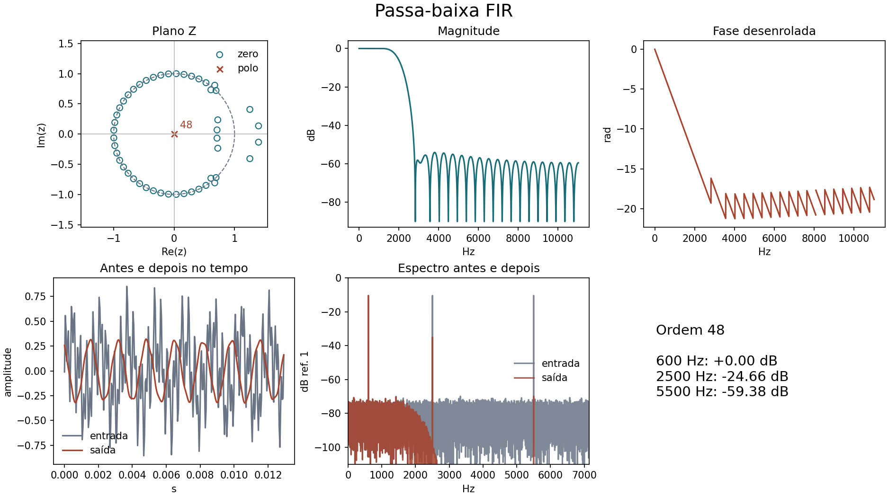
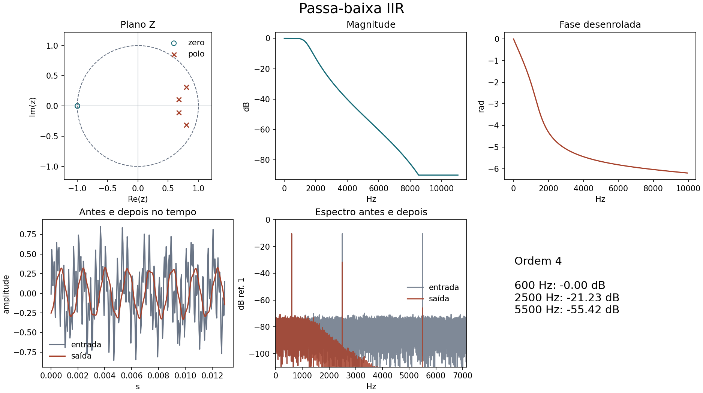
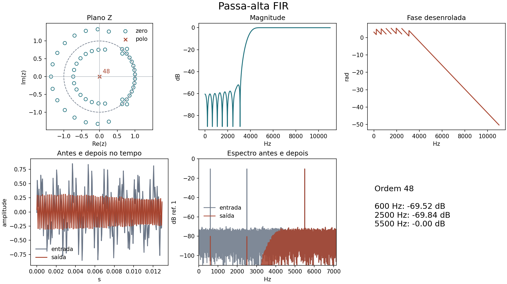
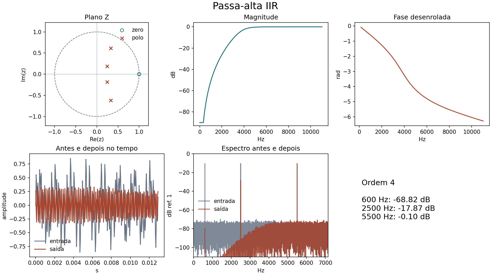
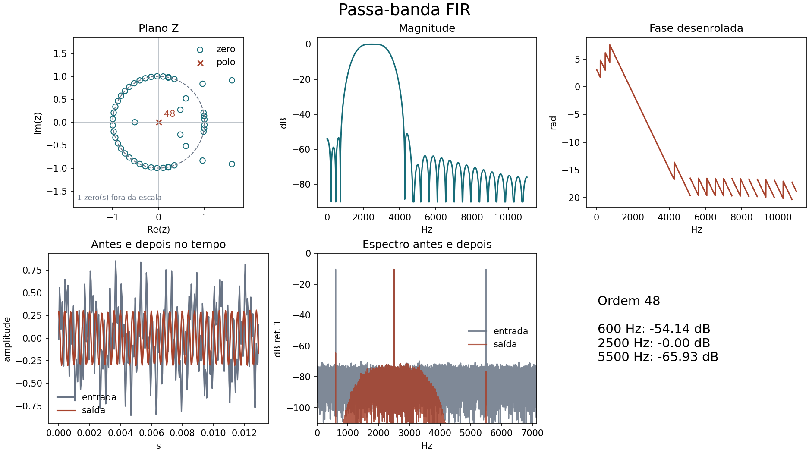
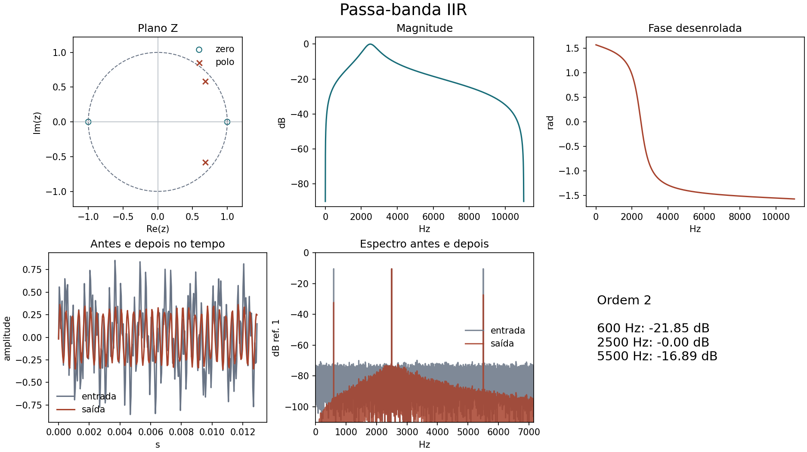
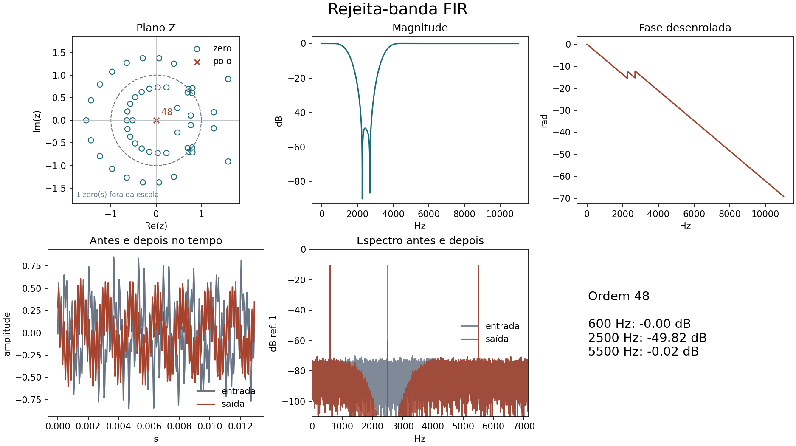
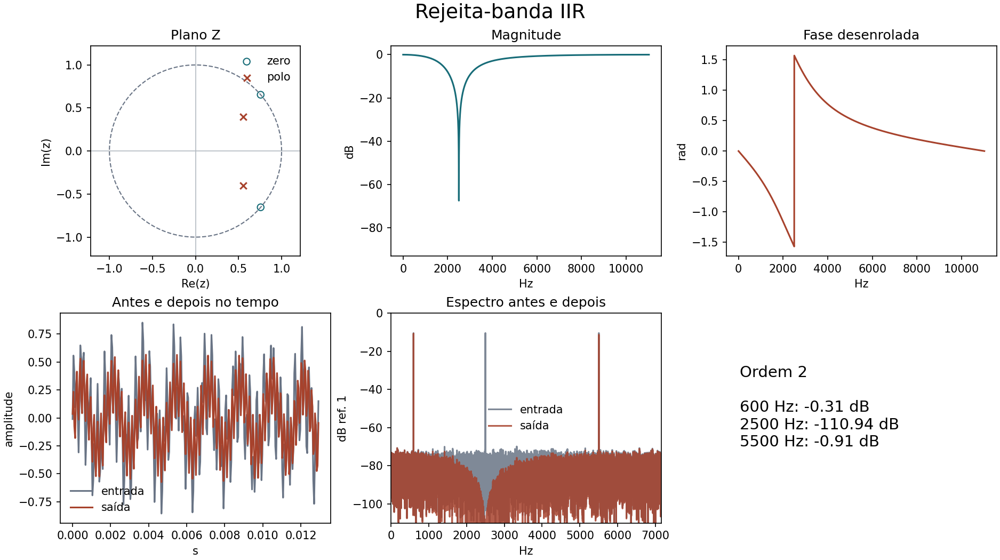
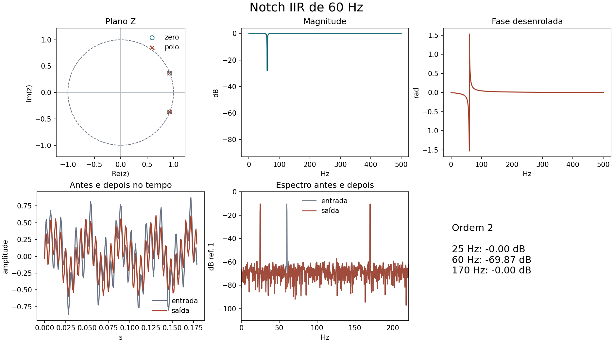

# A2 · Biblioteca de filtros digitais

A biblioteca calcula os coeficientes com NumPy. Matplotlib gera as figuras. A
função `filtrar` aplica a equação de diferenças, amostra a amostra, com repouso inicial.

Em todos os casos, a função de transferência é
`H(z) = (b₀ + b₁z⁻¹ + … + bₘz⁻ᵐ) / (1 + a₁z⁻¹ + … + aₙz⁻ⁿ)`.
A ordem é o maior grau em z⁻¹. Os vetores abaixo estão na ordem dos atrasos. O
CSV traz os coeficientes em precisão de trabalho, raízes, ordens e os ganhos
observados. O número ao lado de uma raiz no plano Z indica multiplicidade. O plano
Z amplia a vizinhança do círculo unitário. O CSV traz as raízes que ficam
fora do recorte e as aproximações numéricas de raízes múltiplas.

## Como os coeficientes são calculados

- **FIR**. A sinc representa um passa-baixa ideal. A janela de Hamming limita
  a resposta a uma quantidade finita de amostras. Para o passa-alta, subtraio
  a sinc do impulso central. Para o passa-banda, subtraio duas sinc. Para o
  rejeita-banda, subtraio esse passa-banda do impulso central.
- **IIR Butterworth**. Os polos do protótipo analógico ficam espaçados no
  semicírculo esquerdo. A frequência é pré-distorcida com
  Ωc = 2fs·tan(πfc/fs). A transformação bilinear leva os polos ao plano Z.
  Os zeros ficam em −1 no passa-baixa e em +1 no passa-alta.
- **IIR de banda**. Uso uma seção biquadrática com frequência central e Q.
  O passa-banda tem zeros em DC e Nyquist. O rejeita-banda tem zeros no
  círculo unitário no ângulo da frequência central. O notch é esse mesmo
  rejeita-banda com Q = 20 para concentrar a rejeição em torno de 60 Hz.

## Escolha da ordem

Os FIR do banco usam ordem 48 (49 coeficientes) para separar os tons de
teste com margem, com 24 amostras de atraso. Mantendo janela e bordas,
encurtar o filtro alarga a transição e reduz custo e atraso. A janela de
Hamming controla lóbulos laterais em troca de uma transição mais larga
que a da janela retangular de mesmo comprimento. Os Butterworth de
ordem 4 têm passagem monotônica. Aumentar a ordem acentua a transição,
mas custa mais operações e pode aumentar a variação de atraso.
Nos biquads, uma seção de ordem 2 já permite obter um par de zeros e
ajustar a largura pelo Q. Os testes verificam as frequências abaixo.

Cada sinal combina três senoides de amplitude 0,3 e ruído gaussiano de
desvio padrão 0,012 com semente 9. As medidas usam os últimos quatro
segundos, após três segundos de acomodação. A FFT usa janela de Hann e
a mesma escala para entrada e saída. O ganho é medido por projeção no
tom. O piso visual em dB evita log de zero. A fase fica indefinida nos
zeros da resposta.

| Filtro | Ordem | Ganho medido nos três tons, em dB |
|---|---:|---|
| Passa-baixa FIR | 48 | 600 Hz +0.00 / 2500 Hz -24.66 / 5500 Hz -59.38 |
| Passa-baixa IIR | 4 | 600 Hz -0.00 / 2500 Hz -21.23 / 5500 Hz -55.42 |
| Passa-alta FIR | 48 | 600 Hz -69.52 / 2500 Hz -69.84 / 5500 Hz -0.00 |
| Passa-alta IIR | 4 | 600 Hz -68.82 / 2500 Hz -17.87 / 5500 Hz -0.10 |
| Passa-banda FIR | 48 | 600 Hz -54.14 / 2500 Hz -0.00 / 5500 Hz -65.93 |
| Passa-banda IIR | 2 | 600 Hz -21.85 / 2500 Hz -0.00 / 5500 Hz -16.89 |
| Rejeita-banda FIR | 48 | 600 Hz -0.00 / 2500 Hz -49.82 / 5500 Hz -0.02 |
| Rejeita-banda IIR | 2 | 600 Hz -0.31 / 2500 Hz -110.94 / 5500 Hz -0.91 |
| Notch IIR de 60 Hz | 2 | 25 Hz -0.00 / 60 Hz -69.87 / 170 Hz -0.00 |

## Comparação FIR e IIR sob a mesma especificação

A tabela de ordem, ripple, rejeição e custo obtida por execução está em
`../A3_resultados/A3_comparativo.csv`. O A3 aplica a mesma biblioteca
e compara os dois passa-baixa com uma única máscara de magnitude.

## Resultados por filtro

### Passa-baixa FIR

- b = `[0.0009511415052372449, 0.0005987367802570683, -3.9446312445725e-05, -0.0009822320175672048, -0.0020742973272022736, -0.002892242981991013, -0.002811505622687398, -0.001268436028365106, 0.0018600742223132878, 0.00593524313084147, 0.00949804015854694, 0.010607994892781707, 0.007557141904480822, -0.0002474216509440955, -0.011571340107635743, -0.02316091393544737, -0.030283695586642033, -0.027963305065110664, -0.012592049835159293, 0.016591123359457404, 0.05669626346829263, 0.10141854601607422, 0.1423577797193491, 0.17109681750027173, 0.18143596762658876, 0.17109681750027173, 0.1423577797193491, 0.10141854601607424, 0.05669626346829264, 0.016591123359457404, -0.012592049835159297, -0.02796330506511067, -0.030283695586642043, -0.02316091393544737, -0.011571340107635743, -0.0002474216509440955, 0.0075571419044808226, 0.010607994892781712, 0.009498040158546946, 0.005935243130841475, 0.0018600742223132878, -0.0012684360283651075, -0.0028115056226873983, -0.002892242981991015, -0.0020742973272022754, -0.0009822320175672044, -3.944631244572505e-05, 0.0005987367802570683, 0.0009511415052372449]`
- a = `[1.0]`

### Passa-baixa IIR

- b = `[0.000987594722589455, 0.00395037889035782, 0.0059255683355367295, 0.00395037889035782, 0.000987594722589455]`
- a = `[1.0, -2.9606962048547483, 3.3890207277844784, -1.7622215407045076, 0.34969853333620876]`

### Passa-alta FIR

- b = `[-0.0010616045438460561, -0.00048203830912401047, 0.0008755167171288915, 0.0017014393585029568, 0.0005255873646104164, -0.002255701036403836, -0.00347593324304458, -0.0002082146983653585, 0.005411367720885116, 0.0063413451587585505, -0.00142794724423032, -0.011203975314355739, -0.009975411921770382, 0.00582843871156909, 0.020855611934457244, 0.013829966229750542, -0.015617732262422312, -0.03722399446858149, -0.01724437860341243, 0.03831392463666413, 0.07210037195309085, 0.019592968566409383, -0.1246724685538914, -0.2844716612042807, 0.6469390366259768, -0.2844716612042807, -0.1246724685538914, 0.019592968566409387, 0.07210037195309087, 0.03831392463666414, -0.017244378603412432, -0.0372239944685815, -0.015617732262422319, 0.013829966229750542, 0.020855611934457244, 0.00582843871156909, -0.009975411921770384, -0.011203975314355744, -0.0014279472442303206, 0.006341345158758555, 0.005411367720885116, -0.00020821469836535878, -0.003475933243044581, -0.002255701036403837, 0.0005255873646104168, 0.001701439358502956, 0.0008755167171288925, -0.00048203830912401047, -0.0010616045438460561]`
- a = `[1.0]`

### Passa-alta IIR

- b = `[0.21217902526460708, -0.8487161010584283, 1.2730741515876425, -0.8487161010584283, 0.21217902526460708]`
- a = `[1.0, -1.1456450507658622, 0.9037186085667154, -0.2994861846104874, 0.04601456029064803]`

### Passa-banda FIR

- b = `[-0.00020157654984516047, -0.00048277839615929434, 3.929170434923294e-05, 0.0007509498644735844, 0.00027308444943119874, -0.002528551413338868, -0.006695779390757691, -0.008637253637124373, -0.004759654747184933, 0.00425195554857581, 0.012206894703212963, 0.012332423475433856, 0.005012820952443415, 4.391399877668578e-06, 0.008032228852743172, 0.027315658759266618, 0.03867731185408696, 0.01835197869985937, -0.03844830820090476, -0.1037374390440549, -0.12952368085163815, -0.08262878987286469, 0.024521079713453263, 0.13447135161396925, 0.18082118734861113, 0.13447135161396925, 0.024521079713453263, -0.0826287898728647, -0.12952368085163815, -0.1037374390440549, -0.038448308200904766, 0.018351978699859377, 0.038677311854086974, 0.027315658759266618, 0.008032228852743172, 4.391399877668578e-06, 0.005012820952443416, 0.012332423475433861, 0.01220689470321297, 0.004251955548575813, -0.004759654747184933, -0.008637253637124385, -0.0066957793907576925, -0.0025285514133388696, 0.00027308444943119895, 0.000750949864473584, 3.9291704349232985e-05, -0.00048277839615929434, -0.00020157654984516047]`
- a = `[1.0]`

### Passa-banda IIR

- b = `[0.09823745340890537, 0.0, -0.09823745340890537]`
- a = `[1.0, -1.364923718532064, 0.8035250931821892]`

### Rejeita-banda FIR

- b = `[0.00020182673650073765, 0.00048337759637585116, -3.934047123263586e-05, -0.0007518819056025901, -0.00027342338808822905, 0.0025316897239312662, 0.00670408985471564, 0.008647973761079782, 0.0047655621908028285, -0.004257232861532987, -0.012222045285773907, -0.012347729857981082, -0.005019042613197418, -4.396850261899976e-06, -0.008042198050425352, -0.027349561578394722, -0.03872531618448611, -0.018374756251006406, 0.03849602830350981, 0.10386619272573318, 0.12968443911719635, 0.08273134456292441, -0.02455151404189753, -0.13463825067914864, 0.8169683308925192, -0.13463825067914864, -0.02455151404189753, 0.08273134456292443, 0.12968443911719635, 0.10386619272573318, 0.038496028303509816, -0.018374756251006413, -0.038725316184486124, -0.027349561578394722, -0.008042198050425352, -4.396850261899976e-06, -0.005019042613197419, -0.012347729857981087, -0.012222045285773914, -0.0042572328615329905, 0.0047655621908028285, 0.008647973761079794, 0.006704089854715642, 0.002531689723931268, -0.00027342338808822926, -0.0007518819056025897, -3.9340471232635906e-05, 0.00048337759637585116, 0.00020182673650073765]`
- a = `[1.0]`

### Rejeita-banda IIR

- b = `[0.7336050625645715, -1.1103975805103268, 0.7336050625645715]`
- a = `[1.0, -1.1103975805103268, 0.46721012512914295]`

### Notch IIR de 60 Hz

- b = `[0.9908808111161014, -1.842595356987258, 0.9908808111161014]`
- a = `[1.0, -1.842595356987258, 0.9817616222322028]`

